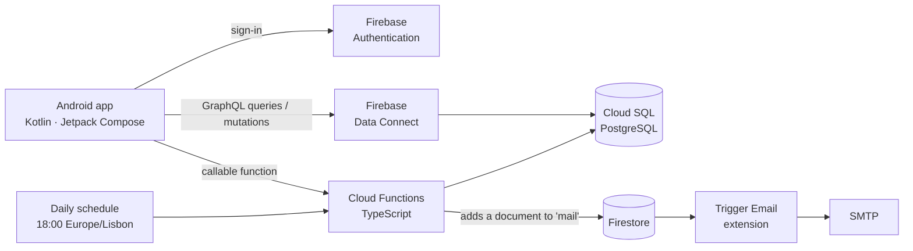

# Loja Social IPCA

Android app for the Social Action Services (SAS) of the Polytechnic Institute of Cávado and Ave (IPCA)
to run the **Loja Social**, a store that gives food, hygiene and school supplies to students
in need. Staff manage stock, donations, beneficiaries and scheduled distributions, and the
backend sends automatic email reminders and stock expiry alerts.

Academic project (*Projeto Aplicado*, BSc in Computer Systems Engineering, IPCA), built by a
team of four between November 2025 and January 2026.

## Features

- **Authentication and roles**: SAS staff and beneficiaries see different parts of the app.
- **Stock**: categories, products and lots, each lot with its quantity and expiry date.
- **Donations and campaigns**: register donations and the items they bring into stock.
- **Beneficiaries**: applications (candidacies), requests and each beneficiary's history.
- **Distributions**: schedule a delivery, pick the lots to hand out and track its status.
  Stock is deducted or returned automatically and atomically.
- **Reports** and an **activity log** of what changed and who changed it.
- **Automatic emails**, sent daily at 18:00 (Lisbon time):
  - a reminder to each beneficiary with a distribution the next day;
  - an alert to SAS staff about lots expiring within 31 days.

## Architecture



- **Data**: a relational PostgreSQL database on Cloud SQL, reached from the app through
  **Firebase Data Connect**, which turns GraphQL queries and mutations into SQL and generates
  a typed Kotlin SDK.
- **Business rules that must be atomic** (changing distribution items and adjusting stock)
  run in a **Cloud Function** inside a single database transaction, so stock can never go
  negative or get out of sync.
- **Scheduled jobs** are Cloud Functions on a daily schedule. They write emails to a
  Firestore collection, and the Trigger Email extension delivers them over SMTP.
- **Secrets**: the database password is stored in **Google Secret Manager** and injected
  into the functions at runtime. It is never in the code or in this repository.

## Tech stack

| Layer | Technologies |
|---|---|
| Mobile app | Kotlin, Jetpack Compose, Material 3, Navigation, Hilt (dependency injection) |
| App architecture | Clean Architecture: `presentation` (views + view models) → `domain` (use cases, models, repository interfaces) → `data` (repositories, data sources) |
| Data access | Firebase Data Connect (GraphQL → SQL, generated Kotlin SDK) |
| Database | PostgreSQL on Google Cloud SQL |
| Backend | Cloud Functions for Firebase (TypeScript, Node.js 20), `pg`, Cloud SQL Connector |
| Auth and email | Firebase Authentication, Firestore, Trigger Email extension |
| Secrets | Google Secret Manager |

## Data model

The PostgreSQL schema has 15 tables, defined in [`dataconnect/schema/schema.gql`](dataconnect/schema/schema.gql):

| Area | Tables |
|---|---|
| Users | `User` |
| Stock | `Category`, `Product`, `Lot` |
| Donations | `Campaign`, `Donation`, `DonationItem` (donation ↔ product) |
| Distributions | `Distribution`, `DistributionItem` (distribution ↔ lot), `StatusType` |
| Beneficiaries | `Beneficiary`, `Candidacy`, `Request` |
| Audit | `Log`, `LogType` |

## Cloud Functions

| Function | Trigger | What it does |
|---|---|---|
| `manageDistributionItem` | Called from the app | Adds, updates or removes an item from a distribution and adjusts the lot's stock in the same transaction. Rejects any change that would make stock negative. |
| `sendDistributionReminders` | Daily, 18:00 | Emails every beneficiary who has a distribution scheduled for the next day. |
| `sendLotExpirationAlerts` | Daily, 18:00 | Emails SAS staff the list of lots that expire within 31 days. |

## Project structure

```
app/                         Android app
  src/main/java/com/example/sas/
    presentation/            Compose screens and view models
    domain/                  use cases, models, repository interfaces
    data/                    repository implementations and data sources
    di/                      Hilt modules
dataconnect/
  schema/schema.gql          database schema
  connector/                 GraphQL queries and mutations used by the app
functions/src/index.ts       Cloud Functions
extensions/                  Trigger Email extension config (*.env.example templates)
firebase.json                Firebase project configuration
```

## Running it yourself

The app needs a Firebase project of your own. The original project's configuration is not
included in this repository.

**Prerequisites:** Android Studio, JDK 11+, Node.js 20 and the [Firebase CLI](https://firebase.google.com/docs/cli).

1. Create a Firebase project and enable Authentication, Firestore and Data Connect
   (which creates the Cloud SQL PostgreSQL instance).
2. Register an Android app with the package name `com.example.sas`, download its
   `google-services.json` and place it in `app/`.
3. For each extension instance, copy the template and fill it in:
   ```bash
   cp extensions/firestore-send-email.env.example extensions/firestore-send-email.env
   ```
4. Store the database password as a secret for the functions:
   ```bash
   firebase functions:secrets:set POSTGRES_PASSWORD
   ```
5. Point `.firebaserc`, `dataconnect/dataconnect.yaml` and the Cloud SQL instance name in
   `functions/src/index.ts` to your project. Then deploy the backend:
   ```bash
   cd functions && npm install && cd ..
   firebase deploy --only dataconnect,functions,extensions
   ```
6. Open the project in Android Studio and run the `app` configuration.

## Team

Alexandre Vilaça · João Paulo Carvalho · João Peixoto · Pedro Alves
